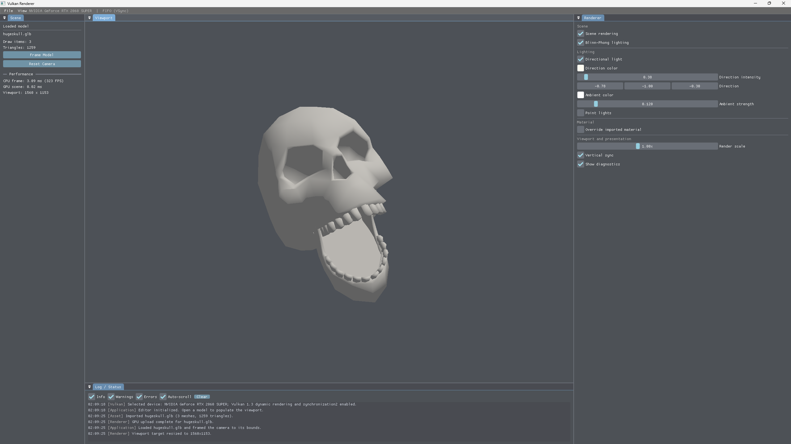

# Vulkan Renderer

A Windows desktop scene viewer built with C++20, Vulkan 1.3, GLFW, Dear ImGui, VMA, GLM, Assimp, and nlohmann/json. The initial release provides a dockable editor, a resizable offscreen viewport, indexed model rendering with Blinn–Phong lighting, orbit/pan/zoom controls, runtime renderer settings, and model replacement through a native file picker.



## Build

Requirements:

- Windows 10 or 11, x64
- Visual Studio 2022 C++ workload
- CMake 3.25 or newer
- Vulkan 1.3 capable driver and Vulkan SDK (the SDK supplies `glslc`)
- Internet access for the first CMake configure, which fetches the versions listed in [`cmake/Dependencies.cmake`](cmake/Dependencies.cmake)

```powershell
cmake --preset windows-vs2022
cmake --build --preset debug
```

Run `out/build/windows-vs2022/bin/Debug/VulkanRenderer.exe`. CMake compiles the GLSL sources to SPIR-V in the build tree; generated shader binaries are not checked into the source tree.

## Use

- Use **File → Open Model** or the viewport placeholder to load `.gltf`, `.glb`, `.obj`, `.fbx`, `.dae`, `.3ds`, `.ply`, `.stl`, `.blend`, or `.x` files supported by the bundled Assimp build.
- Right-drag in the viewport to orbit, middle-drag to pan, and scroll to zoom. Viewport camera input is ignored while a text field is active.
- Adjust scene rendering, Blinn–Phong lighting, directional and point lights, render scale, and vertical sync in the Renderer panel.
- Import errors are shown in a notification and retained in Log / Status. A failed replacement keeps the loaded scene available.

Preferences and the ImGui dock layout are saved under `%APPDATA%\VulkanRenderer`.

